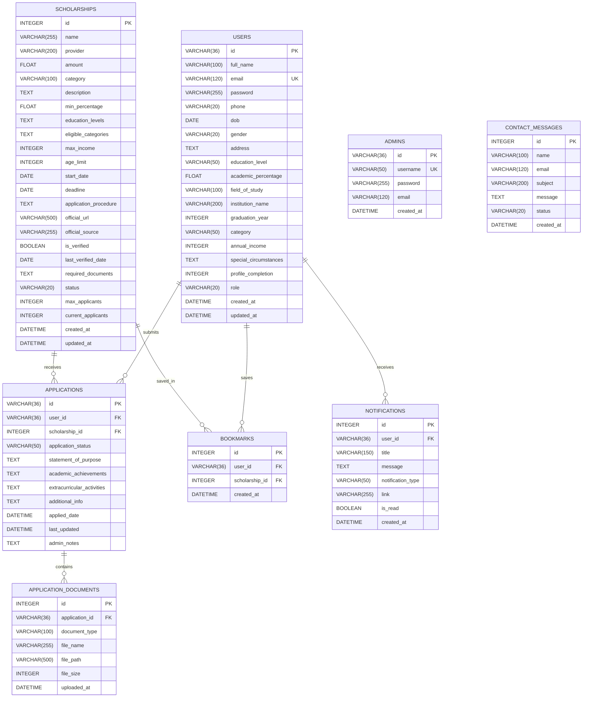

# Student Saarthi - Database Schema Documentation

## 1. Overview and Architecture

The **Student Saarthi** scholarship management portal uses an enterprise-ready relational database schema managed via **SQLAlchemy 2.0 ORM**.

The database architecture is designed with the following principles:
- **Engine Portability:** Out-of-the-box zero-configuration support for **SQLite** (`instance/database/student_saarthi.db`) for lightweight local development and automated testing, with seamless drop-in support for **MySQL** (`mysql+mysqlconnector://`) and **PostgreSQL** (`postgresql://`) in production environments via the `DATABASE_URL` environment variable.
- **Referential Integrity:** Enforces strict Foreign Key constraints, cascading deletes (`ON DELETE CASCADE`) to prevent orphaned application documents, notifications, and bookmarks when user or scholarship entities are removed.
- **Security & Data Protection:** Dedicated `admins` table segregated from regular student `users`, PBKDF2/scrypt password hashing with automatic transparent upgrade for legacy SHA256 hashes, and sanitized document storage paths.
- **Performance Optimization:** Indexes on high-frequency search and filter columns (`email`, `category`, `status`, `deadline`, `user_id`, `scholarship_id`, `is_read`).

---

## 2. Entity-Relationship Diagram (Mermaid)



---

## 3. Comprehensive Entity & Table Specifications

### 3.1 Table: `users`
Stores student accounts, personal profiles, academic qualifications, and socioeconomic criteria for matching and eligibility scoring.

| Column | Data Type | Nullable | Default | Constraints & Keys | Description |
| :--- | :--- | :---: | :---: | :--- | :--- |
| `id` | `VARCHAR(36)` | No | UUIDv4 | **PRIMARY KEY** | Unique student identifier |
| `full_name` | `VARCHAR(100)` | No | - | - | Legal full name of student |
| `email` | `VARCHAR(120)` | No | - | **UNIQUE, INDEX** | Student email for authentication |
| `password` | `VARCHAR(255)` | No | - | - | PBKDF2/scrypt hashed password |
| `phone` | `VARCHAR(20)` | Yes | `NULL` | - | Primary contact phone number |
| `dob` | `DATE` | Yes | `NULL` | - | Date of birth for age eligibility |
| `gender` | `VARCHAR(20)` | Yes | `NULL` | - | Gender identity (Male, Female, Other) |
| `address` | `TEXT` | Yes | `NULL` | - | Residential street address |
| `education_level` | `VARCHAR(50)` | Yes | `NULL` | - | High School, Undergraduate, Post-Graduate, etc. |
| `academic_percentage` | `FLOAT` | Yes | `NULL` | - | Most recent academic score/percentage (0-100) |
| `field_of_study` | `VARCHAR(100)` | Yes | `NULL` | - | Academic major or stream (Engineering, Arts, etc.) |
| `institution_name` | `VARCHAR(200)` | Yes | `NULL` | - | School, College, or University name |
| `graduation_year` | `INTEGER` | Yes | `NULL` | - | Expected or actual year of graduation |
| `category` | `VARCHAR(50)` | Yes | `NULL` | - | Social category (General, OBC, SC, ST, EWS) |
| `annual_income` | `INTEGER` | Yes | `NULL` | - | Annual family income in INR |
| `special_circumstances`| `TEXT` | Yes | `NULL` | - | Disability, single parent, minority status, etc. |
| `profile_completion` | `INTEGER` | No | `85` | - | Computed profile completion percentage (0-100) |
| `role` | `VARCHAR(20)` | No | `'student'` | - | Role identifier (`student`) |
| `created_at` | `DATETIME` | No | `UTC NOW` | - | Record creation timestamp |
| `updated_at` | `DATETIME` | No | `UTC NOW` | - | Last update timestamp |

---

### 3.2 Table: `admins`
Dedicated table for administrative staff and portal operators with elevated privileges.

| Column | Data Type | Nullable | Default | Constraints & Keys | Description |
| :--- | :--- | :---: | :---: | :--- | :--- |
| `id` | `VARCHAR(36)` | No | UUIDv4 | **PRIMARY KEY** | Unique admin identifier |
| `username` | `VARCHAR(50)` | No | - | **UNIQUE, INDEX** | Login username (e.g. `admin`) |
| `password` | `VARCHAR(255)` | No | - | - | Securely hashed password |
| `email` | `VARCHAR(120)` | Yes | `NULL` | - | Admin contact email |
| `created_at` | `DATETIME` | No | `UTC NOW` | - | Account creation timestamp |

---

### 3.3 Table: `scholarships`
Stores authoritative scholarship records, requirements, deadlines, eligibility limits, and official sources.

| Column | Data Type | Nullable | Default | Constraints & Keys | Description |
| :--- | :--- | :---: | :---: | :--- | :--- |
| `id` | `INTEGER` | No | Auto | **PRIMARY KEY** | Unique scholarship identifier |
| `name` | `VARCHAR(255)` | No | - | - | Official title of the scholarship |
| `provider` | `VARCHAR(200)` | No | - | - | Sponsoring ministry, trust, or corporation |
| `amount` | `FLOAT` | No | `0.0` | - | Total financial benefit value (in INR) |
| `category` | `VARCHAR(100)` | No | - | **INDEX** | Merit-Based, Need-Based, Minority, STEM, etc. |
| `description` | `TEXT` | Yes | `NULL` | - | Comprehensive scope and details |
| `min_percentage` | `FLOAT` | No | `0.0` | - | Minimum academic percentage cutoff |
| `education_levels` | `TEXT` | Yes | `NULL` | - | Comma-separated eligible education levels |
| `eligible_categories` | `TEXT` | Yes | `NULL` | - | Comma-separated eligible social categories |
| `max_income` | `INTEGER` | Yes | `NULL` | - | Maximum allowable family income ceiling |
| `age_limit` | `INTEGER` | Yes | `NULL` | - | Maximum student age limit |
| `start_date` | `DATE` | Yes | `NULL` | - | Application window start date |
| `deadline` | `DATE` | Yes | `NULL` | **INDEX** | Application cutoff date |
| `application_procedure`| `TEXT` | Yes | `NULL` | - | Detailed step-by-step instructions |
| `official_url` | `VARCHAR(500)` | Yes | `NULL` | - | Direct external portal or provider URL |
| `official_source` | `VARCHAR(255)` | Yes | `NULL` | - | Authoritative verification source (e.g., NSP) |
| `is_verified` | `BOOLEAN` | No | `TRUE` | - | Verification flag by admin team |
| `last_verified_date` | `DATE` | Yes | Current Date | - | Date of last verification check |
| `required_documents` | `TEXT` | Yes | `NULL` | - | Comma-separated mandatory documents |
| `status` | `VARCHAR(20)` | No | `'active'` | **INDEX** | Lifecycle state (`active`, `expired`, `closed`) |
| `max_applicants` | `INTEGER` | Yes | `NULL` | - | Capacity cap if applicable |
| `current_applicants` | `INTEGER` | No | `0` | - | Number of applications received |
| `created_at` | `DATETIME` | No | `UTC NOW` | - | Timestamp of creation |
| `updated_at` | `DATETIME` | No | `UTC NOW` | - | Timestamp of last modification |

---

### 3.4 Table: `applications`
Stores student applications for specific scholarships, including essays, achievements, and review statuses.

| Column | Data Type | Nullable | Default | Constraints & Keys | Description |
| :--- | :--- | :---: | :---: | :--- | :--- |
| `id` | `VARCHAR(36)` | No | UUIDv4 | **PRIMARY KEY** | Unique application tracking ID |
| `user_id` | `VARCHAR(36)` | No | - | **FOREIGN KEY (`users.id`), INDEX** | Applying student |
| `scholarship_id` | `INTEGER` | No | - | **FOREIGN KEY (`scholarships.id`), INDEX** | Targeted scholarship |
| `application_status`| `VARCHAR(50)` | No | `'Submitted'`| **INDEX** | Status (`Draft`, `Submitted`, `Under Review`, `Approved`, `Rejected`) |
| `statement_of_purpose`| `TEXT` | Yes | `NULL` | - | Student essay / purpose statement |
| `academic_achievements`| `TEXT` | Yes | `NULL` | - | Academic honors and ranks |
| `extracurricular_activities`| `TEXT` | Yes | `NULL` | - | Sports, volunteering, leadership |
| `additional_info` | `TEXT` | Yes | `NULL` | - | Special remarks or notes |
| `applied_date` | `DATETIME` | No | `UTC NOW` | - | Submission timestamp |
| `last_updated` | `DATETIME` | No | `UTC NOW` | - | Last modification timestamp |
| `admin_notes` | `TEXT` | Yes | `NULL` | - | Private reviewer feedback/notes |

#### Relationships & Foreign Keys
- `user_id` references `users(id)` with `ON DELETE CASCADE`.
- `scholarship_id` references `scholarships(id)` with `ON DELETE CASCADE`.

---

### 3.5 Table: `application_documents`
Stores metadata and relative file paths of supporting documents uploaded by students for their applications.

| Column | Data Type | Nullable | Default | Constraints & Keys | Description |
| :--- | :--- | :---: | :---: | :--- | :--- |
| `id` | `INTEGER` | No | Auto | **PRIMARY KEY** | Unique document identifier |
| `application_id` | `VARCHAR(36)` | No | - | **FOREIGN KEY (`applications.id`), INDEX** | Associated application ID |
| `document_type` | `VARCHAR(100)` | No | - | - | E.g. Income Certificate, Marksheet, ID Proof |
| `file_name` | `VARCHAR(255)` | No | - | - | Original uploaded filename |
| `file_path` | `VARCHAR(500)` | No | - | - | Server storage relative path |
| `file_size` | `INTEGER` | Yes | `NULL` | - | File size in bytes |
| `uploaded_at` | `DATETIME` | No | `UTC NOW` | - | Upload timestamp |

#### Relationships & Foreign Keys
- `application_id` references `applications(id)` with `ON DELETE CASCADE`.

---

### 3.6 Table: `bookmarks`
Manages saved / favorited scholarships bookmarked by students for tracking.

| Column | Data Type | Nullable | Default | Constraints & Keys | Description |
| :--- | :--- | :---: | :---: | :--- | :--- |
| `id` | `INTEGER` | No | Auto | **PRIMARY KEY** | Unique bookmark record ID |
| `user_id` | `VARCHAR(36)` | No | - | **FOREIGN KEY (`users.id`), INDEX** | Student who bookmarked |
| `scholarship_id` | `INTEGER` | No | - | **FOREIGN KEY (`scholarships.id`), INDEX** | Bookmarked scholarship |
| `created_at` | `DATETIME` | No | `UTC NOW` | - | Timestamp saved |

#### Unique Constraints
- `UNIQUE(user_id, scholarship_id)` ensures a student cannot bookmark the same scholarship multiple times.

---

### 3.7 Table: `notifications`
Stores personalized system alerts, status updates, deadline reminders, and broadcast announcements.

| Column | Data Type | Nullable | Default | Constraints & Keys | Description |
| :--- | :--- | :---: | :---: | :--- | :--- |
| `id` | `INTEGER` | No | Auto | **PRIMARY KEY** | Unique notification ID |
| `user_id` | `VARCHAR(36)` | No | - | **FOREIGN KEY (`users.id`), INDEX** | Target recipient user ID |
| `title` | `VARCHAR(150)` | No | - | - | Notification subject/title |
| `message` | `TEXT` | No | - | - | Full notification body text |
| `notification_type` | `VARCHAR(50)` | No | `'info'` | - | `info`, `success`, `warning`, `deadline` |
| `link` | `VARCHAR(255)` | Yes | `NULL` | - | Target internal URL |
| `is_read` | `BOOLEAN` | No | `FALSE` | **INDEX** | Unread (`false`) or Read (`true`) |
| `created_at` | `DATETIME` | No | `UTC NOW` | - | Delivery timestamp |

---

### 3.8 Table: `contact_messages`
Stores contact queries submitted through the public Contact Us page.

| Column | Data Type | Nullable | Default | Constraints & Keys | Description |
| :--- | :--- | :---: | :---: | :--- | :--- |
| `id` | `INTEGER` | No | Auto | **PRIMARY KEY** | Unique contact inquiry ID |
| `name` | `VARCHAR(100)` | No | - | - | Submitter's full name |
| `email` | `VARCHAR(120)` | No | - | - | Submitter's email address |
| `subject` | `VARCHAR(200)` | Yes | `NULL` | - | Inquired topic / subject line |
| `message` | `TEXT` | No | - | - | Inquired question or feedback |
| `status` | `VARCHAR(20)` | No | `'unread'` | - | `unread`, `read`, `replied` |
| `created_at` | `DATETIME` | No | `UTC NOW` | - | Submission timestamp |

---

## 4. Database Initialization and Seeding

Database creation and default seed data injection are automated via dedicated CLI scripts:

1. **Schema Initialization:**
   ```powershell
   .\.venv\Scripts\python.exe scripts/init_db.py
   ```
   Inspects all registered SQLAlchemy models and issues `CREATE TABLE IF NOT EXISTS` across all 8 tables.

2. **Seed Data Ingestion:**
   ```powershell
   .\.venv\Scripts\python.exe scripts/seed_db.py
   ```
   - Automatically seeds the root administrative account:
     - **Username:** `admin`
     - **Password:** `admin123` (hashed via PBKDF2)
   - Seeds 10 authentic, verified national and private scholarships (NSP Post Matric, PM-USP, INSPIRE SHE, Tata Capital Pankh, Reliance Foundation, etc.) with real criteria and official application links.

